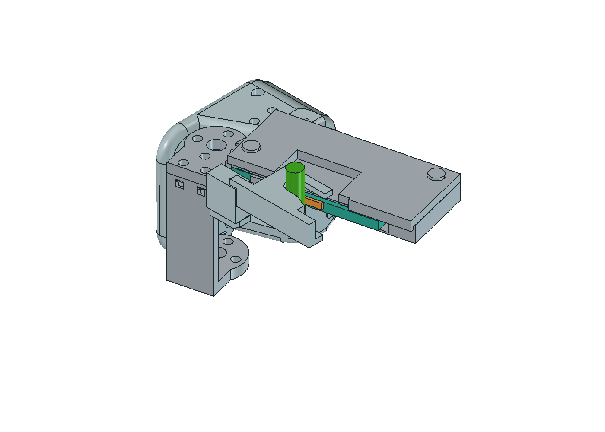

# SO-101 grip-cut v0.4

Start with [the assembly STEP](AEROBERRY-SO101-GripCut-v0.4-assembly.step) for CAD viewing. The [native FreeCAD assembly](AEROBERRY-SO101-GripCut-v0.4.FCStd) preserves the exact source file, including a saved-display issue that rendered blank in this FreeCAD session. The STEP and the new preview provide viewable geometry.

This is the documented September 8 utility-blade prototype revision: a thin solid jaw, compact pads, deeper cut and cleaned blade-cover wings. The reinforced SO-101 wrist root, horn interface, large curved-slot pin and rear brace remain.

Five parts are supplied in `parts/`, each as STEP and STL: P01 fixed jaw, P02 utility-blade carrier, P03 flexure, P04 blade cover and P05 rear brace. Those exports retain assembly coordinates. Reviewed print orientations are in `../04_Print_Orientation_Reference/SO101/`.

The nominal design uses a 9 mm solid working jaw, a 7 mm throat for 0.8–6 mm stems, two 10 × 2.4 × 1 mm soft pads and a 62 × 19 × 0.61 mm utility-blade envelope. It retains the original 14° opening. The 44 mm flexure has a 0.8 mm rest offset; do not substitute the Maker spring.

Reuse original SO-101 servo/horn mounting hardware. Added fasteners are four M3 × 8 socket-head screws and four M3 nuts: two for the blade cover and two for the rear brace. Actual blade and hardware fit require a bench check.

The source records report 2,640 nominal pair checks and 359 interface/stem/offset checks, followed by the cover-only cleanup checks. All five shared part shapes opened as valid solids. The inherited servo reference is visualization geometry with a known source overlap and does not pass the new share-copy shape-validity check. This does not alter the part geometry or establish mounting fit. Physical assembly, cutting torque, holding and spring life remain prototype tests.

See `design.json`, `verification/`, `NOTICE.md` and `reference/` for design details and attribution.
