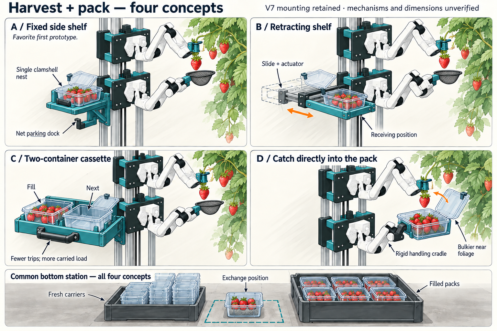

# Harvest and packing concepts — V1

**Current selection:** the user chose A with one supported container. The arms
will not lift filled packs. See [the V8 CAD checkpoint](SINGLE-PACK-CAD.md) for
the resulting parts, static fit evidence and remaining release/motion work.
The comparison below records the earlier ideation, not the current build scope.

Concept exploration after the user accepted the stacked V7 SO-101 mounts.
No changes to the accepted CAD, simulation, contact geometry or policies.

Generated using the built-in image-generation tool, with the actual V7 carriage
render as a reference. These are industrial-design illustrations, not CAD,
kinematic solutions or physical validation. Link geometry, reach, scales and
clearances in an image-generation output must not be treated as ground truth.

## Comparison

| Concept | Arrangement | Why try it | Principal question |
|---|---|---|---|
| A: fixed side shelf | Single clamshell in removable rigid carrier; gusseted shelf attached to the side of the lower carriage, below its arm mounting face | Least additional moving hardware; small catcher can access fruit without carrying the whole pack | Can the actual lower arm reach fruit, deposit positions, net dock and carrier handle without crossing the other arm or braces? |
| B: retracting shelf | One carrier moves on a short slide between receiving and parked positions | Brings the pack toward a convenient deposit pose and clears the workspace afterward | Are the reach gains worth an actuator, moving pinch interfaces, locks and added clearance checks? |
| C: two-container cassette | Two fixed nests on a removable cassette: fill one, then the other | More fruit per visit to the bottom station | Added mass, off-axis moment and width; full cassette exchange may favor a dock mechanism over arm lifting |
| D: direct catch into pack | Lower arm grips a rigid cradle around the open clamshell | Eliminates net-to-container transfer and the shelf | Bulk near plants, changing wrist load, and fruit landing on previously collected fruit; gentle handling is not established |

A is the preferred first CAD candidate. Keep its carrier interface compatible
with a later B-style slide. B is the most useful comparison if A cannot provide
a clean deposit path. C and D remain alternative architectures, not dismissed
on unmeasured payload assumptions.

## Features to carry into the CAD comparison

- Preserve both direct vertical arm mounts and the accepted 200 mm spacing.
  A packaging shelf attaches to the lower carriage; it does not become a
  horizontal arm-mounting platform.
- Model a shallow net held through a rigid handle, with an explicit release
  method to test: controlled tipping versus a gated bottom. Mesh alone is not
  enough to define how fruit leaves the tool or whether it can snag.
- Use a locating carrier with base support, stops and retention, a deliberate
  grasping interface and a clip that keeps the clamshell lid out of the path.
  Account for changing fruit fill and the full open-lid envelope.
- Keep two exchange alternatives explicit: (1) lower arm parks net, grips
  carrier, swaps pack and retrieves net, or (2) a bottom dock pushes/slides a
  carrier out and a fresh one in while the arm keeps its net. Option 2 needs a
  real drive/retention/alignment mechanism; it is not a free transfer.
- The bottom station needs fresh-pack positions, an aligned exchange position
  and supported filled-pack positions. A tote is useful as storage, not as an
  unspecified destination to drop either loose fruit or filled containers.
- Start exchange-layout studies with individually presented fresh carriers.
  The picture's stack of fresh containers is illustrative storage, not a
  designed automatic de-nesting/feeding mechanism. Lid closing and securing
  finished packs remain separate tasks.
- Any lateral shelf load must enter the carriage and guide structure, never
  the thin robot housing. Weight, offset moment and counterweight balance need
  actual mechanical checks once geometry and packaging are selected.

## Packaging scale reference

One commercial example is Pactiv Evergreen YYY9772, a clear PET hinged-lid
strawberry container, listed as 7.34 × 4.84 × 3.22 inches, approximately
186.4 × 122.9 × 81.8 mm. This is an example envelope, not the user's selected
container or a measurement of an open lid. The product is marketed for one
pound of strawberries; that is about 454 g of fruit before container, carrier
and tool mass. A full carrier's wrist load must be checked, not assumed.

Source: https://pactivevergreen.com/products/yyy9772

## Next CAD experiment

Build A and B around one editable packaging envelope, with the exact V7 arm
models. Inspect the full path from catch to deposit, then the bottom exchange.
Compare net/fruit clearance, opening of the lid, reach, arm/brace/shelf
interference, added load and required actuators. No selection is committed by
this concept study.

## Files and provenance

- `concepts.png`: corrected concept sheet, built-in image generation.
- `image-prompt.txt`: initial generation prompt.
- `edit-prompt.txt`: corrective generation prompt.
- `concepts-draft.png`: rejected first sheet; nets were drawn disconnected
  from the lower grippers. Retained as an iteration record, not a valid design.
- Reference: `runs/tower-lift-v7/carriage-preview.png` from the actual CAD review.

Visual review of the corrected sheet: nets connect to lower wrists; A uses an
empty parking dock; containers have visible hinged lids; each panel has two
direct-mounted arms. Illustrations remain conceptual and are not a substitute
for actual tool-grip geometry, robot link geometry or a reach check.
