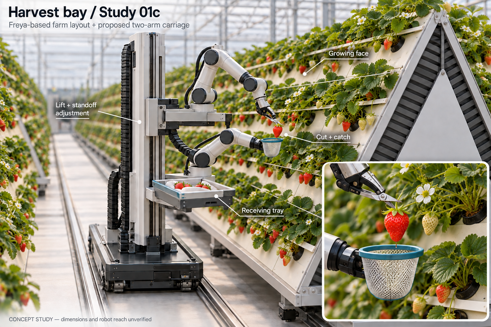

# Harvest bay / Study 01 — design review

2026-09-10. Specification and three image-generation passes, before CAD or simulation changes. **01c is the current proposal for user review, not an approved engineering design.**

[Read the specification](spec-v1.md) · [Research and source hierarchy](../2026-09-10-reference-brief.md)

## Current proposal — 01c

One rail-mounted carriage, vertical positioning and crop-facing standoff adjustment, two compact arms with distinct cut/catch roles, and a nearby receiving tray. The carrier and arms are our proposal; the Freya-style crop architecture is reference-derived. Arm shapes in these generated images are illustrative rather than exact YAM model renders.

## What changed and why

| Pass | Visual result | Review / disposition |
|---|---|---|
| [01](images/study-01-v1.png) | First complete bay and side inset | Layout legible, but net sits beside target; inset omits tray; growing face reads like a hedge. Retained as rejected initial pass. |
| [01b](images/study-01-v2.png) | Reposed catcher and working-detail inset | Net opening is beneath the target rather than beside it. Closeup makes roles understandable. Tool geometry is still conceptual. |
| [01c](images/study-01-v3.png) | Added the real supplier crop photograph to the edit | Visible white panel bands, planting collars and individual foliage rows replace the continuous hedge. Current layout discussion image. |

All three outputs were visually inspected. These reviews evaluate the drawings, not contacts or feasibility. No physics tests were run for these images.

## Remaining discrepancies, ranked by engineering consequence

1. **Exact arm geometry and feasible poses.** The generator drew generic articulated arms despite the YAM reference. These must be replaced by our actual source URDF/meshes at the CAD stage, with exact joints and physical tool envelopes. Do not infer arm reach from this drawing.
2. **Carriage coupling and standoff.** Images suggest upper and lower mounting levels, but do not unambiguously resolve the specified common moving subassembly. Two bases and tray need a coherent load path and coordinated lift/cross-slide motion. Vertical offset must not make one arm unreachable at the lowest or highest crop rows. Select the mechanism from a dimensional reach study, not these pixels.
3. **Tool mechanics and transfer.** The shears look recognizable but the jaw-to-blade actuation is not resolved. Mesh shape does not establish compliance. Transfer over the net rim into a loaded tray needs an actual release path. The small tip filament in the inset is not a modeled tether and must not be translated into the simulation.
4. **Canopy match.** 01c improves row organization but remains cleaner and locally sparser/more regular than the supplier photograph. Restore observed overlapping foliage, unequal fruit counts and branching where task difficulty depends on them. Thin crop lines and broad strips still need classification and dimensions.
5. **Structure and access.** Rack end treatment and mast styling borrow from the customer's concept; they are not supplier drawings. Aisle clearance, base support, loaded tray clearance, cable paths and equipment protection remain unresolved.

The useful next visual decision is whether to keep the mast/carriage architecture and tray location. Then establish a dimensioned side/plan layout with the exact two YAMs before detailed mechanical design. An attractive image is not grounds to skip this step.

## Reusable method captured here

1. Separate customer intent, supplier photos and our design additions.
2. Specify the local task, all interacting objects and the required motion before rendering.
3. Generate one reviewable arrangement rather than a whole imagined facility.
4. Inspect target/tool relationships and omitted components; revise the specific failure.
5. Compare against real photographs and repair structural mismatches, preserving the working concept.
6. Record residual uncertainty and preserve earlier trials; advance to CAD only after the concept-review phase.

## Generation and provenance

All images were made with the **built-in image-generation tool**, not CAD rendering or a running simulator. Exact prompts: [v1](prompt-v1.txt), [v2](prompt-v2.txt), [v3](prompt-v3.txt).

- v1 used the user-supplied City Farmers concept and the existing `docs/evidence/yam-grip-policies/v2-contact-sheet.jpg` solely for arm proportions. Old chart text/results were not design instructions or new evidence.
- v2 edited v1 to correct the cut/catch pose and replace the incomplete side inset with a working detail.
- v3 edited v2 using [Freya's rack photograph](https://freyacultivation.com/media/strawberry-aeroframe.webp) for planting structure. The photo is accessible from [Freya's strawberry system page](https://freyacultivation.com/strawberry-system/). Reference images retain their source ownership; they are not generated assets or supplier-approved drawings.
- Local source-image caches are under `references/` and are excluded from Git; source URLs and filenames are recorded in [reference provenance](references/README.md). The generated concept images, prompts and design notes are versioned.

Only this isolated research worktree was changed. The other task's training, original checkout, servers and compute were left untouched.
