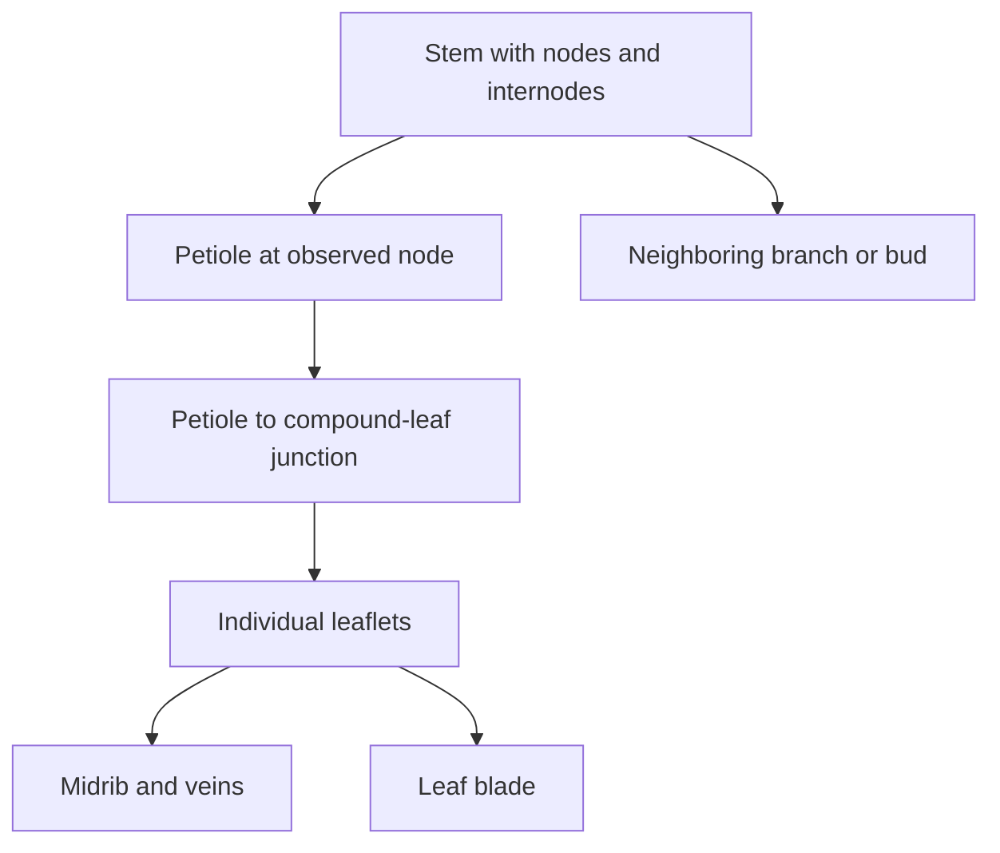

# Specimen-to-simulation plan

Status: proposed engineering representations, not established hemp material laws.

## Research findings

**Leaf shape.** Balant et al. (2024) modeled leaflet outlines within compound leaves, accounting for variable leaflet counts. Their study included 341 leaves across multiple accessions and developmental positions. Its geometry methods are relevant, but the mixed accession dataset is not a representative distribution for our partner's hemp. Geometry research supplies no bending or damage calibration. [LEAF-SHAPE-2024](https://nph.onlinelibrary.wiley.com/doi/10.1111/nph.19817)

**Fresh stalks.** A 2023 industrial-hemp study reports mechanical testing of fresh stalk tissue and finite-element calibration. The sampled organ and stem location differ from a leaf petiole. This supports investigating tissue directionality and organ-specific calibration; its values must not be assigned to leaves or petioles. Direct publisher access returned HTTP 429, so only indexed excerpts have been reviewed. [FRESH-STALK-2023](https://www.mdpi.com/2073-4395/13/7/1918)

**Dry stems.** A hemp/flax study explicitly tests dry stems and the contribution of fibres to bending. It supports the importance of tissue distribution and geometry, but does not calibrate a living hemp specimen. [DRY-STEM-2018](https://www.sciencedirect.com/science/article/abs/pii/S0926669018300347)

**Hydration.** Experiments on other plant species show that hydration and tissue age can change petiole mechanics. This motivates recording specimen condition; it does not establish the size or direction of those effects in hemp. [HYDRATION-1991](https://academic.oup.com/aob/article-abstract/67/1/67/257967)

## Structural representation

Trace connections before generating geometry. Record hidden connections as hypotheses. Preserve natural asymmetry and relative position; do not duplicate a single idealized leaf throughout the scene.

| Component | Initial candidate | Evidence needed |
|---|---|---|
| Stem and petiole | Tapered beam representation with bending and torsion | Centerline, cross-sections, mass, load-response measurements |
| Node and attachment | Explicit connection region with its own compliance | Close-up anatomy and local motion relative to the stem |
| Leaflets | Thin deformable surfaces with midrib support | Outline, thickness, areal mass, folding and twisting response |
| Contact | Collision surfaces checked against visible geometry | Tool/leaf contact observations and numerical penetration audit |
| Separation | Separate model selected after the partner's method is understood | Actual operation and separation behavior |

Reduced beam chains or leaf panels may be suitable for fast diagnostics, but their discretization and contact limitations must be reviewed. Finer geometry is warranted when it changes the observed behavior. No full cellular model is assumed necessary.

## Evidence sequence

1. **Reference specimen:** matched photographs, scale, connection annotations, and whole-specimen plus attachment close-ups. Report visible mismatches before adding a canopy.
2. **Quiet resting state:** settle under gravity without forced pose corrections. Distinguish unloaded geometry from loaded appearance.
3. **Reversible contact:** compare an untouched control with leaf brushing and petiole displacement. Show the instrument, actual contact location, bending, twisting, and recovery. Log forces, impulse, penetration, and unintended contacts.
4. **Calibration and holdouts:** compare measured responses with the model on separate fitting and evaluation specimens. Derive acceptance tolerances from measurement uncertainty and the task, rather than choosing them to pass a simulation.
5. **Removal interaction:** model the partner's actual mechanism. An imposed attachment release may diagnose unloading, but it is not evidence of tool-driven separation. Preserve mass, pose, and velocity through separation.
6. **Learned skill:** train only after the interaction is inspectable. Report precisely which commands are learned, what controller remains underneath, and whether observations are available on the intended robot.

Repeat contact experiments at a smaller timestep and finer discretization. Numerical agreement is separate from biological accuracy. Retain rejected trials.

## Variation and task evaluation

Build variation around coherent specimens: node position, leaf identity, shape, size, mass, posture, and tissue condition must remain linked. Estimate distributions from data; taxonomic ranges alone are not sampling distributions. Keep training seeds and held-out specimens separate.

Evaluate removal of the designated leaf, damage to protected tissues, unintended contacts, completion time, and failure recovery. Faster completion is valuable only within the established contact and actuator constraints. None of these metrics currently has a measured hemp threshold.

Possible specialist decomposition is approach, establish controlled contact, perform the confirmed removal operation, and withdraw. These are provisional task boundaries, not trained skills or a claim that decomposition will outperform one policy.
